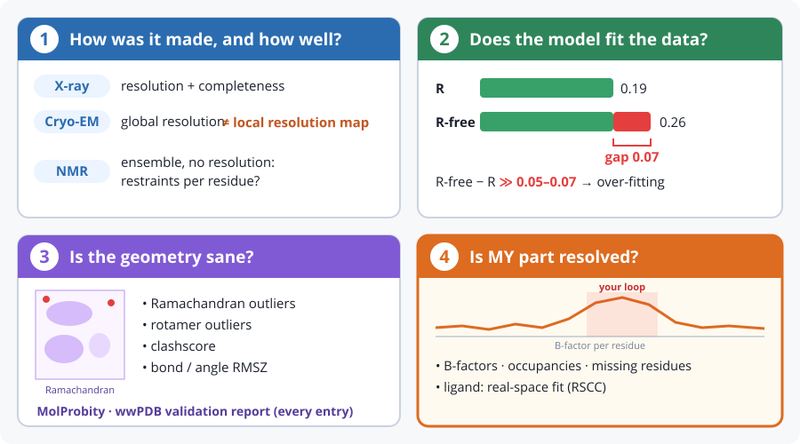
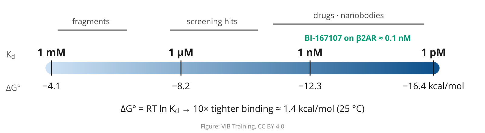
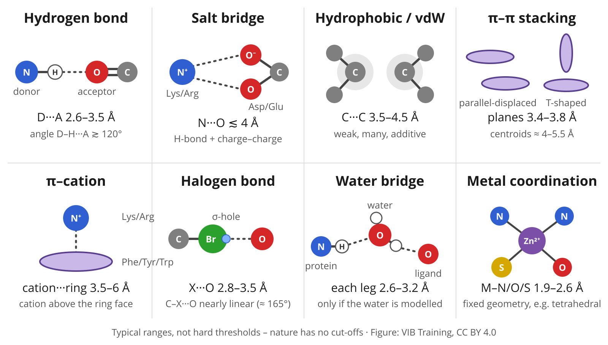
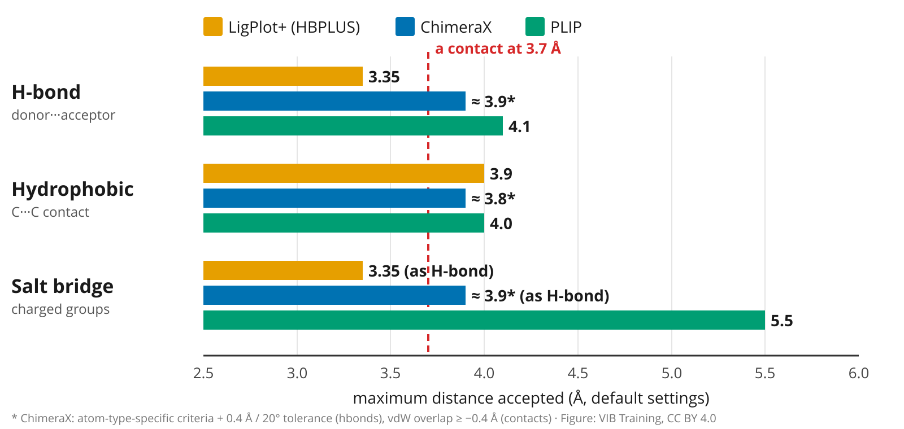
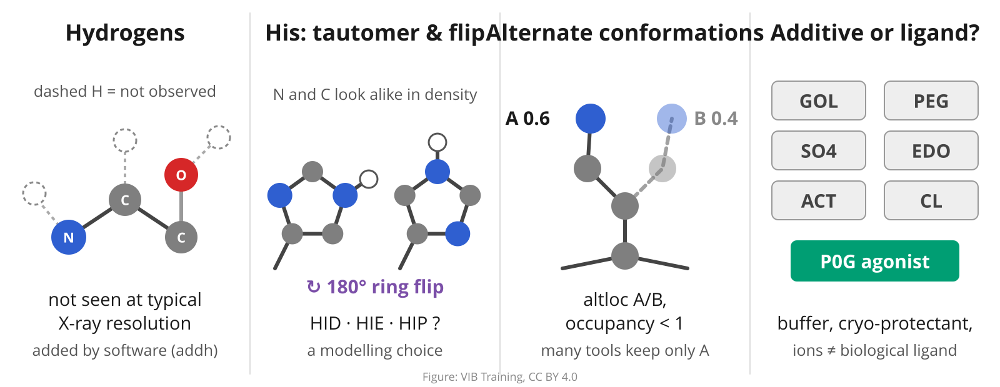
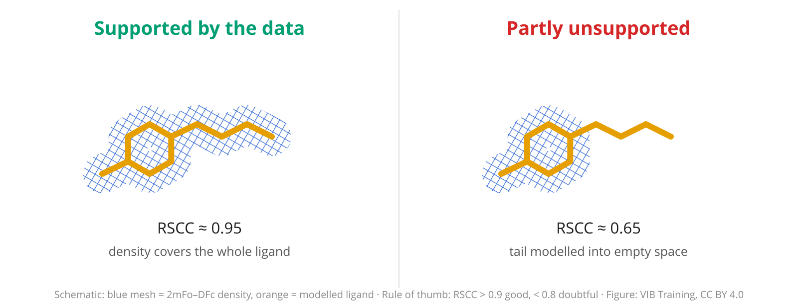
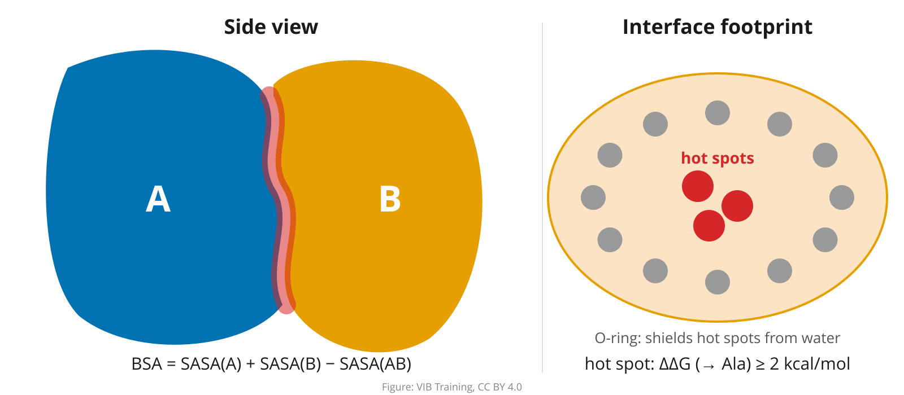

<!--
author:   Alexander Botzki
email:    Alexander.Botzki@vib.be
version:  0.1.1
language: en
narrator: US English Female

comment:  slides Protein Structure Analysis

icon: https://vib.be/sites/vib.sites.vib.be/files/logo_VIB_noTagline.svg

link:     https://cdnjs.cloudflare.com/ajax/libs/animate.css/3.7.2/animate.min.css
link:     https://cdnjs.cloudflare.com/ajax/libs/font-awesome/5.11.2/css/all.min.css
link:     https://fonts.googleapis.com/css2?family=Saira+Condensed:wght@300&display=swap
link:     https://fonts.googleapis.com/css2?family=Open+Sans&display=swap
link: https://raw.githubusercontent.com/vib-training-conferences/protein-structure-analysis/refs/heads/update-november-2026/style.css

-->


# Protein Structure Analysis

- Sequences, structures and databases
- Finding and visualising structures from the  Protein Data Bank
- Comparing structures by structural alignment
- Various exercises about structural exploration
- Modelling mutations with MutateX
- Creating protein models (tomorrow's session)

## Learning outcomes

– Retrieve and critically select experimental and predicted protein structures from the PDB and AlphaFold DB using quality indicators (resolution, R-free, validation report)
– Visualise protein structures and compare homologous proteins in ChimeraX to interpret structural similarities and differences, including the features that determine protein stability.
– Characterise and critically evaluate the interactions in a protein–ligand and a protein–protein complex, using ChimeraX and web-based interaction profilers, and explain why different tools report different interactions.
– Search for structurally similar proteins with Foldseek and evaluate the hits using structural similarity scores.
– Design stabilised protein variants with web-based tools such as PROSS and FireProt and critically compare the proposed mutations.
– Set up, execute and analyse in silico site-saturation mutagenesis experiments on the VSC HPC using MutateX (FoldX).

## Pre-course content

### Relevant databases

                           {{0-1}}
*********************

[**Uniprot**](https://www.uniprot.org/) approx. 570,000 curated sequences (SwissProt)

<!-- width="50%" -->

- mainly determined by large-scale DNA sequencing of individual genes or whole genomes

- increasingly automated annotation

*******************

                                  {{1-2}}
*********************
[http://www.wwpdb.org](http://www.wwpdb.org)

<!-- width="70%" -->

*******************

### Sequences and Structures

!?[What is a protein](https://youtu.be/wvTv8TqWC48)<!-- width="890px" height="488px" -->

<i class="fa fa-cat"></i>

[^1](https://pdb101.rcsb.org/learn/videos/what-is-a-protein-video)

### The Structure-Function Connection

- Folded proteins provide a well-defined 3D arrangement of functional groups, creating microenvironments and active sites.
- Structural changes are often involved in functional  mechanisms  (motor proteins, ...)

<!-- height="600px" -->

!?[](https://www.youtube.com/watch?v=E6LHoKe-zRU&list=PLuIpgNT2hMwRQKFy4okoNQKiJwM8li3Sz&index=13)
!?[](https://www.youtube.com/watch?v=CViLhxiPq1k&list=PLuIpgNT2hMwRQKFy4okoNQKiJwM8li3Sz&index=18)

### PDB File Format

                 --{{0}}--
The Protein Data Bank (PDB) format provides a standard representation for macromolecular structure data derived from X-ray diffraction and NMR studies. This representation was created in the 1970's and a large amount of software using it has been written.


                 {{1-2}}
************************************************

Atomic descriptions in classical PDB format

```
ATOM     21  N  ALEU A 392      64.898 118.959  40.827  0.60 24.19           N  
ATOM     22  N  BLEU A 392      64.981 118.958  40.769  0.45 24.73           N  
ATOM     23  CA ALEU A 392      64.818 117.251  41.235  0.60 22.53           C  
ATOM     24  CA BLEU A 392      64.908 117.527  41.044  0.45 23.55           C  
ATOM     25  C  ALEU A 392      63.999 117.260  40.013  0.60 21.73           C  
ATOM     26  C  BLEU A 392      64.972 116.794  39.706  0.45 22.95           C  
ATOM     27  O  ALEU A 392      64.789 117.304  38.508  0.60 19.91           O  
ATOM     28  O  BLEU A 392      64.270 117.164  38.760  0.45 21.80           O  
ATOM     29  CB ALEU A 392      62.994 117.229  41.239  0.60 22.01           C  
ATOM     30  CB BLEU A 392      63.588 117.170  41.739  0.45 23.26           C  
ATOM     31  CG ALEU A 392      62.020 116.866  42.907  0.60 22.43           C  
ATOM     32  CG BLEU A 392      63.411 117.414  43.240  0.45 24.38           C  
ATOM     33  CD1ALEU A 392      63.906 117.128  42.987  0.60 22.36           C  
ATOM     34  CD1BLEU A 392      62.004 117.019  43.655  0.45 24.55           C  
ATOM     35  CD2ALEU A 392      62.660 117.298  44.405  0.60 22.73           C  
ATOM     36  CD2BLEU A 392      64.432 116.611  44.023  0.45 24.44           C  
ATOM     37  N  AASP A 393      65.422 116.659  39.809  0.60 21.96           N  
ATOM     38  N  BASP A 393      65.827 115.776  39.625  0.45 22.93           N  
ATOM     39  CA AASP A 393      65.972 115.093  38.433  0.60 22.44           C  
ATOM     40  CA BASP A 393      65.967 114.977  38.409  0.45 23.84           C  
ATOM     41  C  AASP A 393      64.830 113.969  38.617  0.60 21.62           C  
ATOM     42  C  BASP A 393      64.900 113.889  38.543  0.45 22.45           C  
ATOM     43  O  AASP A 393      64.810 113.091  39.785  0.60 21.11           O  
ATOM     44  O  BASP A 393      64.962 113.054  39.456  0.45 21.89           O  
ATOM     45  CB AASP A 393      66.589 114.675  39.315  0.60 24.09           C  
ATOM     46  CB BASP A 393      67.374 114.360  38.335  0.45 26.75           C  
ATOM     47  CG AASP A 393      66.965 114.032  38.106  0.60 25.18           C  
ATOM     48  CG BASP A 393      67.888 114.196  36.899  0.45 29.40           C  
ATOM     49  OD1AASP A 393      66.303 115.375  36.780  0.60 25.41           O  
ATOM     50  OD1BASP A 393      67.190 114.588  35.938  0.45 31.28           O  
ATOM     51  OD2AASP A 393      68.508 115.272  37.824  0.60 25.36           O  
ATOM     52  OD2BASP A 393      69.014 113.671  36.724  0.45 32.22           O  
```


************************************************

               --{{1}}--
The original short term goal of the working group was to fulfill the mandate set by the IUCr: to define mmCIF data names that needed to be included in the CIF dictionary in order to adequately describe the macromolecular crystallographic experiment and its results. In January 1997, the mmCIF dictionary was completed and submitted to COMCIFS for review, and version 1.0 was released in June 1997.

                 {{2-3}}
************************************************

Atomic descriptions in mmCIF format [^1](http://mmcif.wwpdb.org/docs/pdb_to_pdbx_correspondences.html)

```
ATOM   21   N N   A LEU A 1 4   ? 64.898 118.959 40.827 0.60 24.19 ? 392  LEU A N   1
ATOM   22   N N   B LEU A 1 4   ? 64.981 118.958 40.769 0.45 24.73 ? 392  LEU A N   1
ATOM   23   C CA  A LEU A 1 4   ? 64.818 117.251 41.235 0.60 22.53 ? 392  LEU A CA  1
ATOM   24   C CA  B LEU A 1 4   ? 64.908 117.527 41.044 0.45 23.55 ? 392  LEU A CA  1
ATOM   25   C C   A LEU A 1 4   ? 63.999 117.260 40.013 0.60 21.73 ? 392  LEU A C   1
ATOM   26   C C   B LEU A 1 4   ? 64.972 116.794 39.706 0.45 22.95 ? 392  LEU A C   1
ATOM   27   O O   A LEU A 1 4   ? 64.789 117.304 38.508 0.60 19.91 ? 392  LEU A O   1
ATOM   28   O O   B LEU A 1 4   ? 64.270 117.164 38.760 0.45 21.80 ? 392  LEU A O   1
ATOM   29   C CB  A LEU A 1 4   ? 62.994 117.229 41.239 0.60 22.01 ? 392  LEU A CB  1
ATOM   30   C CB  B LEU A 1 4   ? 63.588 117.170 41.739 0.45 23.26 ? 392  LEU A CB  1
ATOM   31   C CG  A LEU A 1 4   ? 62.020 116.866 42.907 0.60 22.43 ? 392  LEU A CG  1
ATOM   32   C CG  B LEU A 1 4   ? 63.411 117.414 43.240 0.45 24.38 ? 392  LEU A CG  1
ATOM   33   C CD1 A LEU A 1 4   ? 63.906 117.128 42.987 0.60 22.36 ? 392  LEU A CD1 1
ATOM   34   C CD1 B LEU A 1 4   ? 62.004 117.019 43.655 0.45 24.55 ? 392  LEU A CD1 1
ATOM   35   C CD2 A LEU A 1 4   ? 62.660 117.298 44.405 0.60 22.73 ? 392  LEU A CD2 1
ATOM   36   C CD2 B LEU A 1 4   ? 64.432 116.611 44.023 0.45 24.44 ? 392  LEU A CD2 1
ATOM   37   N N   A ASP A 1 5   ? 65.422 116.659 39.809 0.60 21.96 ? 393  ASP A N   1
ATOM   38   N N   B ASP A 1 5   ? 65.827 115.776 39.625 0.45 22.93 ? 393  ASP A N   1
ATOM   39   C CA  A ASP A 1 5   ? 65.972 115.093 38.433 0.60 22.44 ? 393  ASP A CA  1
ATOM   40   C CA  B ASP A 1 5   ? 65.967 114.977 38.409 0.45 23.84 ? 393  ASP A CA  1
ATOM   41   C C   A ASP A 1 5   ? 64.830 113.969 38.617 0.60 21.62 ? 393  ASP A C   1
ATOM   42   C C   B ASP A 1 5   ? 64.900 113.889 38.543 0.45 22.45 ? 393  ASP A C   1
ATOM   43   O O   A ASP A 1 5   ? 64.810 113.091 39.785 0.60 21.11 ? 393  ASP A O   1
ATOM   44   O O   B ASP A 1 5   ? 64.962 113.054 39.456 0.45 21.89 ? 393  ASP A O   1
ATOM   45   C CB  A ASP A 1 5   ? 66.589 114.675 39.315 0.60 24.09 ? 393  ASP A CB  1
ATOM   46   C CB  B ASP A 1 5   ? 67.374 114.360 38.335 0.45 26.75 ? 393  ASP A CB  1
ATOM   47   C CG  A ASP A 1 5   ? 66.965 114.032 38.106 0.60 25.18 ? 393  ASP A CG  1
ATOM   48   C CG  B ASP A 1 5   ? 67.888 114.196 36.899 0.45 29.40 ? 393  ASP A CG  1
ATOM   49   O OD1 A ASP A 1 5   ? 66.303 115.375 36.780 0.60 25.41 ? 393  ASP A OD1 1
ATOM   50   O OD1 B ASP A 1 5   ? 67.190 114.588 35.938 0.45 31.28 ? 393  ASP A OD1 1
ATOM   51   O OD2 A ASP A 1 5   ? 68.508 115.272 37.824 0.60 25.36 ? 393  ASP A OD2 1
```

************************************************

                 {{3}}
************************************************

mmCIF file looks like a paired collection of data item names and values.

```
data_1DKX
#
_entry.id   1DKX
#
_audit_conform.dict_name       mmcif_pdbx.dic
_audit_conform.dict_version    5.279
_audit_conform.dict_location   http://mmcif.pdb.org/dictionaries/ascii/mmcif_pdbx.dic
#
loop_
_database_2.database_id
_database_2.database_code
PDB   1DKX         
WWPDB D_1000172826
#
_pdbx_database_status.status_code                     REL
_pdbx_database_status.entry_id                        1DKX
_pdbx_database_status.recvd_initial_deposition_date   1996-06-03
_pdbx_database_status.deposit_site                    ?
_pdbx_database_status.process_site                    ?
_pdbx_database_status.SG_entry                        .
_pdbx_database_status.pdb_format_compatible           Y
_pdbx_database_status.status_code_mr                  ?
_pdbx_database_status.status_code_sf                  ?
_pdbx_database_status.status_code_cs                  ?
#
loop_
_audit_author.name
_audit_author.pdbx_ordinal
'Zhu, X.'           1
'Zhao, X.'          2
'Burkholder, W.F.'  3
'Gragerov, A.'      4
'Ogata, C.M.'       5
'Gottesman, M.E.'   6
'Hendrickson, W.A.' 7
#
_citation.id                        primary
_citation.title                     'Structural analysis of substrate binding by the molecular chaperone DnaK.'
_citation.journal_abbrev            Science
_citation.journal_volume            272
_citation.page_first                1606
_citation.page_last                 1614
_citation.year                      1996
_citation.journal_id_ASTM           SCIEAS
_citation.country                   US
_citation.journal_id_ISSN           0036-8075
_citation.journal_id_CSD            0038
_citation.book_publisher            ?
_citation.pdbx_database_id_PubMed   8658133
_citation.pdbx_database_id_DOI      ?
#
```

************************************************

### Exercise in ChimeraX: Show a structure

- Load PDB entry 1TRZ using the File menu.

- Compare the default representations and use the various controls to change the view  of the protein.

- Explore the Edit and View menus to change  various aspects of the graphical representation  of the structure.

- Examine the hydrogen bonding patterns. Display a molecular surface.

- Create an interesting view of the molecule and save it as a high-resolution image.

### Working with ChimeraX

There are great videos on working with ChimeraX that you can access via [a playlist from Brown Lab](https://www.youtube.com/playlist?list=PL4eF1KHNgDfIYSKCS3_S0PTRYtYTV9Myi).

We suggest to start with the first and the second video of this playlist.

### Scene styles

Open the PDB with code 1TRZ in ChimeraX via pasting `open 1TRZ` into the command field at the bottom. This will fetch the structure from the RCSB Protein Data Bank and load it into ChimeraX. Please have a look at the log window where more information about the structure is shown next to the full command `open 1TRZ format mmcif fromDatabase pdb`.

The default view is a quite nice one highlighting the interactions of the side chains of three residues with zinc and sodium atoms as well as selected water molecules.

Changing the molecule display can be easily achieved by toggling the icons *Show* and *Hide* from the sections **Atoms**, **Cartoons** and **Styles** in the `Home` menu.

### Showing and hiding residues

If you click the *Hide* icon followed by the *Show* icon of the **Atoms** section, all atoms and residues are shown by default. Toggling the Cartoons to state *Show* doen not explicitly show atoms and residues but are merely a impressionistic representation of the structure. The menu command **Actions** --> **Atoms/Bonds** --> **Show Sidechain/Base**, to a certain extent, shows atoms, but only of side chains, not main chain atoms. Mostly to do structure analysis, we want to show only the most interesting residues, the ones we want to analyze, and hide all the others.

The structure of insulin was crystallized together with some water molecules. In many cases, it is no problem to permanently delete those waters via `Select > Residues > HOH` followed by `Actions > Delete`. To visualize the water molecules, got to `Select > Residues > HOH` followed by `Atoms/Bonds > Show`. Do you see the red water (oxygen) atoms floating around the surface?

There are several ways to show the residues of interest:

  From the sequence selector. Via `Tools > Sequence > Sequence Viewer`, you will see the sequence selector opening. Search for Cys7 from Molecule B, select the residue (will get green) and click on `Atoms > Show`..

Now show the atoms of His5 in Molecule B using a method of choice.

And now that we’re on it, what is special about the two cysteines we just visualized?

Hiding individual atoms or residues works in the same way as showing them, only now you should go to Hide in the menu.

### Showing and Hiding Secondary Structure

Most published molecular images show a detailed active site and all the rest is hidden for clarity. From the previous exercise we show the atoms of 3 residues (let’s assume this is our active site). Now secondary structure of the rest of the molecule is also still visible. To hide all that, we do not have to hide atoms, but hide the secondary structure from the rest of the structure. Atoms and residues are balls and sticks, ‘secondary structure’ is an artistic impression of the structure (beta sheet arrows, helix ribbons, …).

So let’s hide many of the secondary structure, but keep just a few stretches around our active site. Our active site is Cys7 (A), Cys7 (B) and His 5 (B). This can be done in several ways. Since we would have to hide almost everything, I propose to hide first everything and then show again those stretches that we want. But if you have a better idea, I would like to hear it.

Hide all secondary structure via Cartoons > Hide 

Open the Sequence viewer and select the stretches via the mouse.

Then show stretches of residues 2-10 in Mol B and residues 4-10 in Mol A in Cartoons > Show.

There are still some metal-bound histidines flying around that weren’t hidden because they are metal bound. Hide those histidines by clicking on one of the sidechain atoms, go to `Select > Broaden ` and click `Atoms > Hide`.

The metal coordination bonds can be hidden simply by selecting the model 1.1 and hide it by un-checking the checkbox next to the colored square. 

Et voilà, a publication ready image!


### Labels

You can put labels on the residues you want to highlight by selecting an atom from a residue (right-click in default mode). Subsequently, you select `Actions > Label > Residues` and choose the formatting of the label.

Via the same menu, you can change the height to 0.7 A or e.g. 20 pixels.

### Colors

You can color on all levels: atoms, residues, molecules and objects. So be careful, if you color a residue, all of its atoms will get that color. If you color a molecule, all atoms in that molecule will get that color.

Let’s color the secondary structure (the backbone in our case) of our active site in orange. But the sidechains should keep their Element colors. So we shouldn’t color entire residues, but only a selected atom set. Therefore our selection will be at the atom level, not the residue level. Go to `Actions > Color > All Options` and unselect the objects to which coloring applies.

Then select the orange color and select `Apply`. Hopefully, it is a satisfying result.

### Saving the work 

It would be a pitty that you spent hours creating fancy molecular graphics for that next paper while you can’t continue on the work the next day. That’s why ChimeraX can save the entire session including orientations, colors, views, everything. To save the current session, go to File > Save and select `ChimeraX session` as File type.

Choose a filename such as `MyInsulin.cxs`. To load the work again in ChimeraX go to `File > Open`.

### Save as high-quality image

To save the current view to a high quality publication ready image file, click on the Snapshot icon which will save a PNG file at the default location. 


## Let's start with the amino acids and peptide structure

<!-- width="100%" -->

!?[Proteins are polypeptides of aminoacids](https://www.youtube.com/watch?v=iBV67yamqlA&list=PLuIpgNT2hMwRQKFy4okoNQKiJwM8li3Sz&index=20)

## Protein Data Bank

                            {{0}}
*******************

[**Protein Data Bank**](http://www.wwpdb.org) approx. 263,000 experimentally determined structures

<!-- width="50%" -->

- Mainly determined by X-ray crystallography, electron microscopy and recently lesser high-resolution NMR spectroscopy
- Automation is increasing, but there are still significant limitations in the rate of solving new structures

*******************

                                {{0-1}}
**********************************
- contains structures of  proteins, nucleic acids  and complexes
- No purely theoretical or ab initio models  (since 2006)
- Also stores supporting experimental data
- Full deposition now  required by all peer-reviewed journals

*******************

## Exercise 1: Search the PDB

- Use the UniProt site to search for “dnak”.  
- Use the PDB site to search for “dnak”.
- Compare the UniProt and PDB result lists.
- Use the sequence search function to see if there are structures with sequences similar to that of the  DnaK C-terminal domain.
- Look at the summary pages of a number of  structures and note some interesting properties.
- Select a number of structures and create a report page.

### Search for a structure

            {{0}}
*************************
**Via [UniProt](http://www.uniprot.org/)**

The way of searching for a specific protein structure depends on the data you already have. You might already have the PDB ID (a unique identifier), that's an easy one. But mostly you have the protein name or you just have a sequence. In the last cases I recommend to start from the UniProt website at [http://www.uniprot.org](http://www.uniprot.org), which is the best annotated protein database in the world. Our first model protein will be the molecular chaperone DnaK from *E. coli*.

> <i class="fa fa-pencil-alt"></i> **Explore a PDB structure on the Uniprot web site**
>
> 1. Go to the UniProt website and search for the DnaK protein
>
>    * The UniProt search engine returns a list of DnaK protein sequences from a variety of organisms. 
>      An entry with accession code **P0A6Y8** and entry name **DNAK_ECOLI** should be near the top of this list.
> 2. Click on the *accession code* (column Entry) to view the protein page of this DnaK from the model organism *Escherichia coli*.
> 3. Click on *Structure* in the left-side menu and then look at the *3D structure databases* table.

Guidelines which PDB structures to select

Which structures (give the 4-character PDB ID) of the C-terminal domain of DnaK should preferentially be use for analysis and why?

<details>

> <summary>Solution</summary>
>
> Usually, the recommended selection criteria are using an X-ray structure with low resolution and low $R_{free}$ factor. Furthermore, the PDB database has pre-calculated a validation report for all of the structures.
>
> As an example, have a look at https://www.ebi.ac.uk/pdbe/entry/pdb/4EZX under the section 'Experiments and Validation'. 
> For many PDB structures, there is also a re-done structure available with a vast amount of information on the quality of the X-ray structure and suggested 'better' models e.g. (https://pdb-redo.eu/db/4ezx). 
> In our case, we could opt for the structures 1DKX and 4EZX.
>
> This is a difficult example since there are so many high resolution structures available. So, it is recommended to study the articles and compare the available structures to find your favorite structure for further analysis.

</details>

****************

           {{1}}
*********************
**Via the Protein Data Bank by PDB ID**

You can find structural information directly at the PDB database. The web site of the PDB consortium is located at http://www.wwpdb.org. This web site provides links to all members of the PDB (left side). It is a question of taste which resource you start off with. For X-ray structures, it is currently PDBe, RCSB PDB, PDBj. For NMR structres, you find the BMRB. In today's course, we focus on the PDB resources only.

If we visit RCSB at [http://www.rcsb.org](http://rcsb.org) you can start your search for structures.

The PDB entry with ID **1DKX** contains the atomic coordinates of the molecular chaperone (DnaK) from *E. coli*.

> <i class="fa fa-pencil-alt"></i> **Explore a PDB structure on the Uniprot web site**
>
> 1. Go to the PDB website and type 1DKX in the search box 
>
> This will lead you to a page with similar information than on UniProt. 

************

                 {{2}}
******************
**Via the Protein Data Bank by sequence**

In lots of cases we only have a sequence of which we would like to find out if there is structural information. The PDB can be searched using a sequence as input. Here is the sequence of the C-terminal substrate binding domain of DnaK:

```
DVKDVLLLDVTPLSLGIETMGGVMTTLIAKNTTIPTKHSQVFSTAEDNQSAVTIHVLQGERKRAADNKSLGQFNLDGINPAPRGMPQIEVTFDIDADGILHVSAKDKNSGKEQKITIKASSGLNEDEIQKMVRDAEANAEADRKFEELVQTRNQGDHLLHSTRKQVEEAGDKLPADDKTAIESALTALETALKGEDKAAIEAKMQELAQVSQKLMEIAQQQHAQQQTAGADASANNAKDDDVVDAEFEEVKDKK
```

The PDB allows sequence searches through the same search box we used before.


There is also an Advanced Search section, with a Blast/Fasta option in the Sequence Features section.


> Hands-on: BLAST search for PDB structure
>
> 1. Go to the Advanced Search section
> 2. Please select 'Sequence BLAST/PSI-BLAST' in the Query type drop down.
>    This method allows you to change some parameters for the search.
> 3. Copy and paste the sequence in the ''Sequence'' field
> 4. Press ''Submit query''.
> 5. You should see the same structures popping up as you saw in the UniProt page of DnaK.

*****************

## Exercise 2: Getting to know PDB entries 

The primary data format for PDB data is the [PDBx/mmCIF format](https://pdb101.rcsb.org/learn/guide-to-understanding-pdb-data/beginner%E2%80%99s-guide-to-pdb-structures-and-the-pdbx-mmcif-format). There is a legacy [PDB format](http://www.wwpdb.org/documentation/file-format-content/format33/v3.3.html) which is still very popular. 

A PDB (Protein Data Bank) file is a plain text file that contains the
atom coordinates of a solved 3D structure of a protein or even DNA. Such
coordinate files can be obtained at the Protein Data Bank at
[http://www.rcsb.org/](http://www.rcsb.org/). Each PDB entry has a unique identifier (ID)
consisting of 4 characters, the first one is always a number. 
Note: It has been announced that the 4 character code will change in the [future](https://www.wwpdb.org/news/news?year=2017\#5910c8d8d3b1d333029d4ea8).

### Inspecting a PDB entry

The PDB entry with ID **1DKX** contains the atomic coordinates of the
molecular chaperone (DnaK) from *E coli*.

> <i class="fas fa-pencil-alt"></i> **Hands-on: BLAST search for PDB structure**
>
> 1. Go to the PDB website at [http://www.rcsb.org/](http://www.rcsb.org/)
> 2. Type 1DKX in the search and try to answer the questions in the following step.

> <i class="fas fa-question"></i> **Questions**
>
> 1. How many molecules were solved in this PDB file? What kind of molecules are these (proteins, peptides, DNA, ...)?
> 2. Does the structure represent the full protein? If not, how many residues are missing? Hint: Click on the UniProt KB link in the Sequence tab to see the full sequence.
> 3. Was this structure solved by X-Ray or NMR?
> 4. What is the atomic resolution and R-factor?

<details><summary><i class="fa fa-question-circle"></i> Solution</summary>

>  1. Two, called polymers or chains: they are polypeptides
>  2. To answer this question you can go to the sequence tab at the top:
>
>   * Summary: a large chunk of the N-terminus is missing from the structure, the C-terminus is virtually complete.
>
>  3. X-RAY diffraction, as shown by Experimental Details
>  4. Atomic resolution: 2.00 Ångstrom and R-factor of 0.206

</details>

### Downloading the structure

> <i class="fas fa-pencil-alt"></i> **Hands-on: BLAST search for PDB structure**
>
> 1. Go to the PDB website at [http://www.rcsb.org/](http://www.rcsb.org/)
> 2. Type 1DKX in the search box. 
> 3. The file that holds the 3D coordinates can be downloaded by clicking on
>    *Download files* in the top right corner and then choosing *PDBx/mmCIF Format*. For convenience, save this file on your desktop. The filename is the 4-character unique PDB ID.


> <i class="fas fa-pencil-alt"></i> **Hands-on: Open downloaded PDB file in an editor**
>
> 1.   Open this file with a text editor, e.g. WordPad is an excellent tool for that.
> 2. Do you see the different sections in the PDB file? Analyse some ATOM lines and try to explain what kind of data is in each column.

Additional exercises on searching PDB can be found on the [basic bioinformatics exercises page](http://wiki.bits.vib.be/index.php/Exercises_on_Protein_Structure).

## PDB Format

<!-- height="600px" -->

## Occupancy

<!-- width="750px" -->

[^1](https://pdb101.rcsb.org/learn/guide-to-understanding-pdb-data/dealing-with-coordinates)

                 --{{0}}--
Macromolecular crystals are composed of many individual molecules packed into a symmetrical arrangement. In some crystals, there are slight differences between each of these molecules. For instance, a sidechain on the surface may wag back and forth between several conformations, or a substrate may bind in two orientations in an active site, or a metal ion may be bound to only a few of the molecules. When researchers build the atomic model of these portions, they can use the occupancy to estimate the amount of each conformation that is observed in the crystal. For most atoms, the occupancy is given a value of 1, indicating that the atom is found in all of the molecules in the same place in the crystal. However, if a metal ion binds to only half of the molecules in the crystal, the researcher will see a weak image of the ion in the electron density map, and can assign an occupancy of 0.5 in the PDB structure file for this atom. Occupancies are also commonly used to identify side chains or ligands that are observed in multiple conformations. The occupancy value is used to indicate the fraction of molecules that have each of the conformations. Two (or more) atom records are included for each atom, with occupancies like 0.5 and 0.5, or 0.4 and 0.6, or other fractional occupancies that sum to a total of 1.

## PDB File Surprises

- Missing atoms, residues and loops  
- Multiple molecules in the asymmetric unit
- Incomplete oligomers due to coincident crystal and  oligomer symmetry
- Cα-only models
- alternate conformations
- multiple models, especially for NMR ensembles
- use of B factors to represent other properties  
- other non-standard extensions (PDBQT, ...)

## Additional databases and services

- Nucleic Acid Database: DNA and RNA structures

  [http://ndbserver.rutgers.edu/](http://ndbserver.rutgers.edu/)

- PDB-REDO: automatically re-refined deposited structures, using the latest methods

  [https://pdb-redo.eu//](https://pdb-redo.eu/)

- EBI: many online tools for structure analysis

  [http://www.ebi.ac.uk/Tools/structure/](http://www.ebi.ac.uk/Tools/structure/)

- Replaced Electron Density Server: convenient overview of quality parameters for crystal structures

  [http://www.ebi.ac.uk/pdbe/litemol](http://www.ebi.ac.uk/pdbe/litemol)

- BioMagResBank: experimental data for NMR-  derived structures (lists of distance restraints  and other experimentally derived properties)

  [https://bmrb.io/](https://bmrb.io/)

- BioIsis: database of SAXS-derived structures

  [http://www.bioisis.net](http://www.bioisis.net)

- EMBL database of SAXS-derived structures

  [http://www.sasbdb.org](http://www.sasbdb.org)

- EM Databank for cryo-EM structures

  [http://www.emdatabank.org](http://www.emdatabank.org.left)

### Quiz: assessing structure quality

A cryo-EM entry reports a global resolution of 3.0 Å. What does that tell you about your loop of interest?

- [( )] It is resolved at 3.0 Å
- [(X)] Nothing certain; you need the local resolution map
- [( )] It is less well resolved than an X-ray structure
- [( )] The R-free is probably low
***
**Solution:** Global and local resolution are not the same number. Check the local resolution map.
***

Which quality number is available for an X-ray structure but not for an NMR ensemble?

- [( )] Clashscore
- [( )] Ramachandran outliers
- [(X)] Resolution
- [( )] Rotamer outliers
***
**Solution:** NMR gives an ensemble and has no resolution. Geometry checks apply to all models.
***

For an NMR structure, which question is most useful for judging how well it is defined?

- [( )] What is the R-free?
- [(X)] How many restraints per residue were used?
- [( )] What is the completeness?
- [( )] What is the global resolution?
***
**Solution:** Restraints per residue is the NMR counterpart to resolution.
***

A structure has R = 0.19 and R-free = 0.30. What is the most likely problem?

- [( )] Low data completeness
- [(X)] Over-fitting of the model
- [( )] Too many Ramachandran outliers
- [( )] Missing hydrogens
***
**Solution:** The R-free − R gap is 0.11, well above ~0.05–0.07, which suggests over-fitting.
***

Which values would you consider acceptable, based on the R-free − R gap?

- [(X)] R = 0.20, R-free = 0.24
- [( )] R = 0.18, R-free = 0.30
- [( )] R = 0.15, R-free = 0.28
- [( )] R = 0.22, R-free = 0.35
***
**Solution:** Only the first pair has a gap (0.04) below ~0.05–0.07.
***

Which of these is *not* a geometry check reported by MolProbity or the wwPDB validation report?

- [( )] Clashscore
- [( )] Rotamer outliers
- [( )] Bond-length and angle RMSZ
- [(X)] Number of NOE restraints per residue
***
**Solution:** NOE restraints per residue describe the experimental data of an NMR structure, not the model geometry.
***

A structure has an excellent resolution (1.5 Å) and a clean validation report, but your ligand sits in a region with poor density. What should you do?

- [( )] Trust it, since the global quality is excellent
- [(X)] Check the ligand's real-space fit, B-factors and occupancy before interpreting its interactions
- [( )] Only check the Ramachandran plot
- [( )] Re-calculate the R-free
***
**Solution:** Global quality says nothing about your ligand. Always check the local part.
***

## Assessing Structure Quality: four questions to ask before you trust a structure



                         --{{0}}--
How was it made, and how well? X-ray: resolution and completeness. Cryo-EM: a global resolution plus a local resolution map — they are not the same number. NMR: an ensemble, with no resolution at all; ask how many restraints per residue. 2. Does the model fit the data? R and R-free. The gap matters as much as the values: an R-free − R difference much above ~0.05–0.07 suggests over-fitting. 3. Is the geometry sane? Ramachandran and rotamer outliers, clashscore, bond-length and angle RMSZ. MolProbity computes these; the wwPDB validation report ships them with every entry. 4. Is the part I care about resolved? This is the one people skip. Global quality says nothing about your loop, your side chain or your ligand. Look at per-residue B-factors, occupancies, missing residues, and the real-space fit of the ligand.

             {{1}}
***************

General geometric properties (bond lengths and angles, Ramachandran distribution, …):
[MolProbity](https://molprobity.lbl.gov/)

**Crystal Structures**

- Diffraction data resolution and completeness (PDB)
- Final $ R_{cryst} $ and $ R_{free} $ factors (PDB)
- PDBe entry analysis tab [example 3p0g](https://www.ebi.ac.uk/pdbe/entry/pdb/3p0g/analysis)
- [PDB Redo](https://pdb-redo.eu/)

**NMR Structures**

- Number of distance restraints and additional experimental data sources [BMRB](https://bmrb.io)

**Other techniques**

- Difficult to generalise: carefully read and consider the  published protocol

***********

### The wwPDB validation report, and PDB-REDO

TODO: add illustration

                 {{0}}
Every PDB entry has one, reachable from the entry page at RCSB or PDBe. The summary is the percentile slider figure — the same one already used on the “Is the ligand really there?” slide for 3P0G, so reuse that image and point out that participants have met it before. Read it as: further to the left is worse than most of the archive, further to the right is better. The ligand section gives, per ligand instance: real-space correlation coefficient (RSCC), real-space R, and geometry outliers against the Chemical Component Dictionary. This is the check you run before you analyse any binding site — direct bridge to the 13:00 block. PDB-REDO (pdb-redo.eu) re-refines every X-ray entry with current methods and makes the before/after comparison explicit. Side chains move, waters come and go, and occasionally a ligand does not survive. Worth one sentence: “if your conclusion changes between the deposited and the re-refined model, it was never a structural conclusion.” Mention in passing that this is also how you judge an AlphaFold model, with different numbers: pLDDT per residue, PAE between domains — and that neither is an experimental observation.

## Molecular Graphics Software

- [PyMOL](http://www.pymol.org/): high-quality output,  good examples on [Wiki](http://www.pymolwiki.org/)
- [ChimeraX](https://www.cgl.ucsf.edu/chimerax/): good  documentation on website
- [VMD](https://www.ks.uiuc.edu/Research/vmd/): excellent for the analysis of MD trajectories
- [Yasara](http://www.yasara.org)  
- [SwissPDBViewer](http://spdbv.vital-it.ch/)

## ChimeraX

- ChimeraX is the next-generation molecular visualization program from the [UCSF RBVI](https://www.rbvi.ucsf.edu/). 

- Provides high-performance rendering of large structures and data

- Calulate fast and robust solvent-excluded surfaces

- Integration with AlphaFold and ESMFold AI-predicted protein structures (fetch existing or calculate new) 

### The minimum toolkit: about fifteen commands

|      Purpose           |      Commands                                                                |      Example                                                              |
|------------------------|------------------------------------------------------------------------------|---------------------------------------------------------------------------|
|     Get a structure    |     open                                                                     |     open 1csp · open 3p0g · open P02649 fromDatabase alphafold            |
|     Look               |     cartoon, show, hide, style, view                                         |     hide atoms · show :P0G atoms · style :P0G stick · view sel            |
|     Choose             |     select (zones, chains, residues)                                         |     select :P0G · select sel :<5 & protein · select /A                    |
|     Colour             |     color                                                                    |     color bychain · color byhetero · color bfactor palette   bluered      |
|     Surfaces           |     surface, mlp, coulombic                                                  |     surface protein · mlp · coulombic                                     |
|     Measure            |     distance, hbonds, contacts, clashes, interfaces, measure   buriedarea    |     hbonds :P0G restrict cross reveal true log true                       |
|     Compare            |     matchmaker, morph                                                        |     matchmaker #2 to #1 · morph #1,2                                      |
|     Change             |     swapaa, addh, delete                                                     |     swapaa :159 trp log true · addh · delete :HOH                         |
|     Keep               |     save, the Log                                                            |     save site.png supersample 3 · save work.cxs · Log ▸ Save   as .cxc    |


## Structure Alignment

Structures can be structurally aligned to achieve the best possible match between corresponding atoms. It is  possible to consider all atoms, or only a subset  (such as the Cα atoms).

When the structures are very similar, determining  which atoms should be matched to each other is trivial. When there are larger differences, it takes more preparation.

Different algorithms use different combinations of sequence- and secondary of tertiary structure-based information.

- [DALI](http://ekhidna.biocenter.helsinki.fi/dali_server/) [^1](https://raw.githubusercontent.com/vib-training-conferences/protein-structure-analysis/refs/heads/update-november-2026/Holm and Sander, 1993 and Holm 2019 https://doi.org/10.1093/bioinformatics/btz536)
- [TM-Align](https://zhanglab.ccmb.med.umich.edu/TM-align/)
- [DeepAlign](https://www.nature.com/articles/srep01448)
- [LGA](https://dx.doi.org/10.1093%2Fnar%2Fgkg571)
- [CE](https://doi.org/10.1093/protein/11.9.739)
- [FatCat](https://doi.org/10.1093/bioinformatics/btg1086)
- [MUSTANG](http://lcb.infotech.monash.edu.au/mustang/mustang_psfb-final.pdf)
- [MMLigner](https://doi.org/10.1093/bioinformatics/btw757)

### Exercise 4: Compare Structures

- Download the five provided PDB files and open them in ChimeraX.

- Use *matchmaker* function to align the four last structures with the first one.

- Check the reported root mean square deviations as well as the number of residues matched.

$$ rmsd = \sqrt{\frac{1}{N}\sum_{i=1}^{N}R_{i}^{2}} $$

- Color all structures by B factor and compare the distribution to the local variability of the structures.

#### Structural comparison and RMSD 

We compare structures by structurally aligning them on top of each other. That is, we
align structurally equivalent atoms. For now, we will only use CA atoms as a representation of the backbones. 
You always need to specify:

-  source object(s): the structure(s) that needs to be rotated and translated to superpose on anoth
er structure
-  target object: the structure to superpose on

An optimal alignment is found when the root-mean-square deviation (RMSD) is at a minimum. 
The RMSD is given as:

$$ rmsd = \sqrt{\frac{1}{N}\sum_{i=1}^{N}R_{i}^{2}} $$

where R is the distance between two structurally equivalent atom pairs (CA in our case) and n is the total number of atom pairs.

> <i class="fas fa-pencil-alt"></i> **Hands-on: Data download**
>
> 1. Download the following adapted PDB files from [Zenodo](https://zenodo.org/record/3550492#.XdeNL1dKiUk) 
>
>    ```
>    1DKX_1.pdb 1DKY_1.pdb 1DKZ_1.pdb 3DPO_1.pdb 3DPP_1.pdb 
>    ```

### Aligning multiple structures using ChimeraX

> <i class="fas fa-pencil-alt"></i> **Hands-on: Loading PDF files and structurally align them**
>
> 1. Now load all of them in :
>
>    ```
>    File > Open 
>    ```
>
> 2. Type the following command in the command interface:   
>
>    ```
>    matchmaker #2-5 to #1 
>    ```
>
> Notice that ChimeraX prints the RMSD of every structural alignment in the console.
>
> 3. Color the atoms by their B-factor:
>
>    ```
>    Molecule Display > Coloring > Bfactor 
>    ```
>
> High BFactors are red, low BFactors are blue.

> <i class="fas fa-question"></i> **Questions**
>
> Do you see a correlation between the BFactors and the variability in the structure? 

<details><summary><i class="fa fa-question-circle"></i> Solution</summary>

>  

</details>

#### Morphing

TODO: Morphing of exercise 4

https://rbvi.github.io/chimera-tutorials/presentations/modules/chimerax-comp-structures/index.html#/0/31

#### Export the work as a script

TODO: add example command

https://bioinformaticsdaily.com/basics/structural-bioinformatics/structure-visualization-pymol-chimera

## Protein–ligand and protein–protein interactions

                 --{{0}}--
Ask the room who works on a complex. A structure shows which groups face each other; it does not show how strong the binding is, how long the ligand stays, or what it costs to strip off the water. Each ten-fold gain in affinity is only about 1.4 kcal/mol – roughly one good hydrogen bond, or less.

<div style="display:flex;flex-wrap:wrap;gap:2rem;align-items:center;justify-content:center">

<div style="flex:1;min-width:320px;font-size:1.5em;line-height:1.6">
<b>Affinity</b> – how tightly?<br>
<b>Specificity</b> – only the right partner?<br>
<b>Selectivity</b> – this target, not its relatives?
</div>
</div>

### Affinity ranges of ligands

                 --{{0}}--
A complex structure gives you a pose – not an affinity. These ranges are the reference for the worksheet in Exercise 8. They are ranges, not thresholds: interaction strength falls off continuously with distance and angle. Programs draw a line somewhere, nature does not. 



[^1](Illustration: David S. Goodsell and RCSB PDB, Molecule of the Month https://doi.org/10.2210/rcsb_pdb/mom_2008_4" Adrenergic Receptors, CC BY 4.0)


### Interaction types: geometry and distances

                 --{{0}}--
Read the red line: a donor–acceptor pair at 3.7 Angstrom is no hydrogen bond for LigPlot+, a hydrogen bond for PLIP, and for ChimeraX it depends on the atom types and the angle. In the exercise you will see exactly this on the β2 adrenoceptor ligand.



### Every program has its own definition

                 --{{0}}--
Read the red line: a donor–acceptor pair at 3.7 Angstrom is no hydrogen bond for LigPlot+, a hydrogen bond for PLIP, and for ChimeraX it depends on the atom types and the angle. In the exercise you will see exactly this on the β2 adrenoceptor ligand.



> Same structure, different tool 
> → different interaction list
>
> -- An interaction is an operational definition.

[^1](Defaults: PLIP (Adasme et al. 2021, <a href="https://doi.org/10.1093/nar/gkab294">NAR 49:W530</a>)
[^2](LigPlot+/HBPLUS Laskowski &amp; Swindells 2011)
[^3](ChimeraX <a href="https://www.cgl.ucsf.edu/chimerax/docs/user/commands/hbonds.html">hbonds</a> and <a href="https://www.cgl.ucsf.edu/chimerax/docs/user/commands/clashes.html">contacts</a> documentation. Angles and atom typing differ too.)

### What is not in the PDB file

                 --{{0}}--
Connect back to the occupancy slide. Hydrogens decide which atom is the donor, so protonation and histidine flips change the hydrogen-bond list. Waters can be structural, displaceable, or noise. In the exercise, run hbonds before and after addh and compare.

> Every interaction program first <b>adds what is missing</b> – and each one guesses differently.



### Is the ligand really there?

                 --{{0}}--
Lead question: what would convince you that this ligand is correctly modelled? A ligand is a hypothesis of the crystallographer. Check the density fit, the ligand geometry in the validation report, and whether PDB-REDO keeps it. A ligand without density support gives you an interaction list that means nothing.

<div style="display:flex;flex-wrap:wrap;gap:2rem;align-items:center;justify-content:center">


</div>

- Real-space fit (RSCC) 
- ligand section of the wwPDB validation report 
- <a href="https://pdb-redo.eu/db/3p0g">PDB-REDO</a> re-refinement

[^1](Right: wwPDB validation report for PDB 3P0G (CC0). Further reading: Pozharski et al. 2013, Acta Cryst D 69:150–167.)

### Interfaces: why counting H-bonds gives no affinity

                 --{{0}}--
This bridges the ligand part and the nanobody part of the exercise. Tools: ChimeraX interfaces and measure buriedarea, PDBePISA, FoldX AnalyseComplex. Warn already here: a FoldX interaction energy is not a binding free energy.

<div style="display:flex;flex-wrap:wrap;gap:2rem;align-items:center;justify-content:center">



</div>

- Buried surface area 
- shape complementarity
- a few hot spots carry most of the binding energy. Every H-bond made in the complex replaced one water → net gain is small

[^1](Right: β2AR–Nb80, PDB <a href="https://www.rcsb.org/structure/3P0G">3P0G</a> Rasmussen et al. 2011, image RCSB PDB, CC0) 
[^2](Hot spots: Bogan &amp; Thorn 1998, <a href="https://doi.org/10.1006/jmbi.1998.1843">J Mol Biol 280:1</a>.)

### Distances

Distances between atoms are calculated as follows:

 * Select the first atom
 * Keep SHIFT pressed and select the second atom.
 * Go to `Tools > Structure Analysis > Distances` and click on 'Create'.

### Hydrogen bonds

To show hydrogen bonds, you can go to Analysis section in the Molecule Display tab. Before you click on the `H-bonds` icon, it is recommended to define a search space by selecting residues or molecules between which you would like to calculate hydrogen bonds. 
    
To hide or remove the hydrogen bonds, you have multiple choices: use `Molecule Display > Hide H-bonds` or select the hydrogen bonds object in the Models overview on the right side of the ChimeraX window and click on *Close*. 

### Surfaces

It can be very useful and informative to show the molecular surface of a protein. you can visualize cavities, ligand binding sites, etc … To show the molecular surface of one monomer of dimeric insulin, go to `Molecule Display > Surfaces > Show`.

In our case, 4 surfaces will be calculated which display status and color can be individually changed using the toggles in the Models window.

<<<<<<< HEAD
## Protein–ligand and protein–protein interactions

<div style="display:flex;flex-wrap:wrap;gap:2rem;align-items:center;justify-content:center">

<div style="flex:1;min-width:320px;font-size:1.5em;line-height:1.6">
<b>Affinity</b> – how tightly?<br>
<b>Specificity</b> – only the right partner?<br>
<b>Selectivity</b> – this target, not its relatives?
</div>
</div>


<p style="font-size:1.5em;text-align:center"><b>A complex structure gives you a pose – not an affinity.</b></p>

<small>Illustration: David S. Goodsell and RCSB PDB, Molecule of the Month <a href="https://doi.org/10.2210/rcsb_pdb/mom_2008_4">Adrenergic Receptors</a> (CC BY 4.0)</small>

                 --{{0}}--
Ask the room who works on a complex. A structure shows which groups face each other; it does not show how strong the binding is, how long the ligand stays, or what it costs to strip off the water. Each ten-fold gain in affinity is only about 1.4 kcal/mol – roughly one good hydrogen bond, or less.

### Interaction types: geometry and distances


                 --{{0}}--
These ranges are the reference for the worksheet in Exercise 8. They are ranges, not thresholds: interaction strength falls off continuously with distance and angle. Programs draw a line somewhere, nature does not.

### Every program has its own definition


<p style="font-size:1.4em;text-align:center">Same structure, different tool → <b>different interaction list</b>. An interaction is an operational definition.</p>

<small>Defaults: PLIP (Adasme et al. 2021, <a href="https://doi.org/10.1093/nar/gkab294">NAR 49:W530</a>), LigPlot+/HBPLUS (Laskowski &amp; Swindells 2011), ChimeraX <a href="https://www.cgl.ucsf.edu/chimerax/docs/user/commands/hbonds.html">hbonds</a> and <a href="https://www.cgl.ucsf.edu/chimerax/docs/user/commands/clashes.html">contacts</a> documentation. Angles and atom typing differ too.</small>

                 --{{0}}--
Read the red line: a donor–acceptor pair at 3.7 Angstrom is no hydrogen bond for LigPlot+, a hydrogen bond for PLIP, and for ChimeraX it depends on the atom types and the angle. In the exercise you will see exactly this on the β2 adrenoceptor ligand.

### What is not in the PDB file


<p style="font-size:1.4em;text-align:center">Every interaction program first <b>adds what is missing</b> – and each one guesses differently.</p>

                 --{{0}}--
Connect back to the occupancy slide. Hydrogens decide which atom is the donor, so protonation and histidine flips change the hydrogen-bond list. Waters can be structural, displaceable, or noise. In the exercise, run hbonds before and after addh and compare.

### Is the ligand really there?

<div style="display:flex;flex-wrap:wrap;gap:2rem;align-items:center;justify-content:center">


</div>

<p style="font-size:1.4em;text-align:center"><b>Real-space fit</b> (RSCC) · <b>ligand section</b> of the wwPDB validation report · <b><a href="https://pdb-redo.eu/db/3p0g">PDB-REDO</a></b> re-refinement</p>

<small>Right: wwPDB validation report for PDB 3P0G (CC0). Further reading: Pozharski et al. 2013, Acta Cryst D 69:150–167.</small>

                 --{{0}}--
Lead question: what would convince you that this ligand is correctly modelled? A ligand is a hypothesis of the crystallographer. Check the density fit, the ligand geometry in the validation report, and whether PDB-REDO keeps it. A ligand without density support gives you an interaction list that means nothing.

### Interfaces: why counting H-bonds gives no affinity

<div style="display:flex;flex-wrap:wrap;gap:2rem;align-items:center;justify-content:center">


</div>

<p style="font-size:1.4em;text-align:center">Buried surface area · shape complementarity · <b>a few hot spots carry most of the binding energy</b><br>Every H-bond made in the complex replaced one to water → <b>net gain is small</b></p>

<small>Right: β2AR–Nb80, PDB <a href="https://www.rcsb.org/structure/3P0G">3P0G</a> (Rasmussen et al. 2011), image RCSB PDB (CC0). Hot spots: Bogan &amp; Thorn 1998, <a href="https://doi.org/10.1006/jmbi.1998.1843">J Mol Biol 280:1</a>.</small>

                 --{{0}}--
This bridges the ligand part and the nanobody part of the exercise. Tools: ChimeraX interfaces and measure buriedarea, PDBePISA, FoldX AnalyseComplex. Warn already here: a FoldX interaction energy is not a binding free energy.

=======
>>>>>>> c627d96 (update presentation)
### TODO: adapt to ChimeraX Exercise 8: Study Protein-Ligand Interactions

The goal of this exercise is appreciate how protein interactions can be studied through visual inspection and other software tools. Protein interactions can be classified into different groups regarding the molecular properties and functions of the interacting partners. (These groups are intertwined in several cases.) Some examples include:

- the interactions of proteins with other proteins, small molecules, carbohydrates, lipids or nucleic acids;
- Receptor-ligand interactions;
- Peptide-protein interactions;
- Antigen-antibody interactions;
- Enzymatic interactions, enzyme-inhibitor interactions.

#### Exploring the structure of a nanobody-stabilized active state of the β2 adrenoceptor - the ligand 

We will start with exploring one crystal structure of the β2 adrenoceptor. Together with the Steyaert lab from VIB, Kobilka published several crystal structures of the β2 adrenoceptor in its various activation states (Rasmussen et al. Nature 2011, 477)

       {{1}}
**********
> <i class="fas fa-pencil-alt"></i> **Get the structure**
>
> 1. Download the crystal structure 3P0G from the PDB into ChimeraX. 
>
>    ```
>    open 3P0G   
>    ```
>    As you can immediately appreciate, it is a bigger crystal structure with more than one molecule. 


> <i class="fas fa-question"></i> **Questions**
>
> 1. How many molecules are present in the crystallized structures? 
> 2. And how many chain identifiers are used? 

<details><summary> Solution</summary>

> 1. There are three molecules, chain A Beta-2 adrenergic receptor; Endolysin, chain B Camelid Antibody Fragment, and a small molecule ligand. 
>     Also have a look at PDBe [3P0G](https://www.ebi.ac.uk/pdbe/entry/pdb/3p0g) which gives a very nice overview of the structure and its composition.
> 2. Only two chain identifiers A and B. Sometimes, this leads to issues depending on the software you might want to use for downstream processing.

</details>

*****************

           {{2}}
*****************
Some software routines need seperate chain identifiers for molecular entities to work correctly, so we suggest to rename the small molecule to chain L.

> <i class="fas fa-pencil-alt"></i> **Rename the chain of a residue** 
>
> 1. Select the residue
> 
>    ```
>    Tools - Structure Editing - Change Chain IDs
>    ```
>    In the subsequent dialogue enter 'L' while keeping 'To the one' highlighted.
>
> 2. Confirm with 'OK'
 

We first have a look whether we can find out if there are specific interactions of the small molecule ligand with the adrenoreceptor.

In order to do so, we could add hydrogens to all present molecules first.

> <i class="fas fa-pencil-alt"></i> **Add hydrogens to the molecules** 
>
> Tools - Structure Editing - Add hydrogens 

Note: ChimeraX does not need hydrogens to be present to calculate hydrogen bonds.

> <i class="fas fa-pencil-alt"></i> **Select the ligand**
>
> ```
> Select - Residues - P0G
> ```
>
> Note: in the Log panel on the right side, you identify that there is a non-standard residue present in the structure.

> <i class="fas fa-pencil-alt"></i> **Calculate hydrogen bonds** 
>
> ```
> Tools – Structure Analysis – H-bonds 
> ```
> check Limit by selection and
> check the Log checkbox at the bottom of the dialogue
> and press OK in the subsequent window

***************

         {{3}}
*************
Given that hydrogen bonding is dependent on the definition of a hydrogen bond in the program, it is not a bad idea to use other tools to compare the analysis. There are many options to do this online if you look at published crystal structures. Next to the tools which are directly linked out from the web site of the crystal structure at the PDB database you can use the [ProteinPlus server](http://proteinsplus.zbh.uni-hamburg.de/)

Go to the web site of ProteinPlus and enter the PDB code 3P0G into the search box. After clicking on Go, you should be presented with on overview of tools the ProteinPlus server provides.

We do not go into great detail on all the tools but only mention PoseView. With this tool, you can prepare an automatic sketch of the small molecule-protein interactions.


> <i class="fas fa-question"></i> **Questions**
>
> 1. Between which amino acids and the ligand do you see hydrogen bonds using ChimeraX? 
> 2. According to PoseView, between which amino acids and the ligand do you see hydrogen bonds?
> 3. What other interactions are presented in the sketch?
> 4. Inspect the visualisation in ChimeraX: Do you see the interactions in ChimeraX as well?

<details><summary>Solution</summary>

> 1. In ChimeraX, you observe hydrogen bonds between Asp113A as well as the carbonyl function of Asn312A and the charged amine function.
> 2. PoseView indicates hydrogen bonds between Asp113A as well as the carbonyl function of Asn312A and the charged amine function. Furthermore, hydrogen bonds are indicated between the phenolic OH and Ser207A and Ser203A as well as the amine function and Ser203A.
> 3. Furthermore, hydrophobic interactions are indicated for the methylbenzyl moiety and pi-pi interactions of Phe290A and the phenolic moiety.
> 4. With ChimeraX, those hydrophobic interactions can also be visualised.
> 5. Explore the tool in `Tools > Structure Analysis > Contacts` and the help of ChimeraX. 

</details>

*****************

#### Exploring the structure of a nanobody-stabilized active state of the β2 adrenoceptor - the nanobody 

In order to estimate the binding energy between the nanobody and the β2 adrenoceptor, we can use the FoldX tool AnalyseComplex. It is recommended to calculate these binding energies on energy-minimized structures. To illustrate the effect of the energy minimization, we compare the interaction energy of the current crystal structure and its minimized structure.

##### Comparing the active and the inactive conformation of the β2 adrenoceptor 

In case, there is still time, I would recommend to try to use some of your capabilities you learned today and create a superposition of the inactive and active conformation of the β2 adrenoceptor. We take one of the crystal structures which are available: 3SN6

```
open 3SN6
```

You might be overwhelmed once the structure is loaded into ChimeraX. 
In order to get a first quick overview, click on the 'View' buttom in the right menu of the Models window. Then, it is time to look at the PDB entry of 3SN6 in the PDB database to have a first idea on what molecules are in the PDB file.

As you see on the website [3SN6](http://www.rcsb.org/pdb/explore/explore.do?structureId=3SN6i), the chain R consists of 2 molecules, the β2 adrenoceptor and lysozyme. 
In the corresponding article, it is stated that 'the unstructured amino terminus of the β2AR is replaced with T4 lysozyme (T4L)'.

Since this is an extra molecule in the crystal structure which disturbes our view, we will delete it.

After the manipulation, the overall picture should look roughly like this.


In the following step, we structurally align only the receptors. The rest of the structures will move along.
It is suggested to use the first chain A from 3P0G as target and structurally align the receptor from 3SN6.

Investigate the differences in TM helices and the binding of the nanobody compared to the subunit of the G protein.

Tip: Color the secondary structures to better identify the individual chains/units of G protein.

Extra: Use the tool FoldX tool AnalyseComplex

>
>
> 1. Given that energy-minimization takes a while for this rather large complex,
>     please download the Yasara scene [here](http://data.bits.vib.be/pub/trainingen/PSA/3P0G_1.sce)
>
>    Calculate the interaction energies between the chain A and B of the object 3P0G
>    and the RepairObj1, respectively.
>
>    ```
>    Analyze - FoldX - Interaction energy of molecules
>    ```

> <i class="fas fa-question"></i> **Questions**
>
> 1. What is the dG in the two cases?
> 2. Any idea why the difference is rather hugh?

<details><summary>Solution
</summary>

> 1. first case (X-ray structure): Interaction energy between molecule(s) A and B in object 1 = -9.86 (kcal/mol)
>    second case:
>    Interaction energy between molecule(s) A and B in object 2 = -20.19 (kcal/mol)
> 2. Through the energy minimisation of the Repair Object function, the interactions of the amino acids are optimised.

</details>


This command also creates a list of residues forming the interface of the two proteins. Hit space to see the list of residues in the interface.

Tip: This list can also be useful if you want to make visualisations of the interaction site.

```
Plugin>interface residues between A and B
Plugin>TA66 TA68 IA72 IA127 RA131 AA134 IA135 TA136 SA137 PA138 FA139 KA140 QA142 YA219 VA222 EA225 AA226 LA266 KA267 EA268 AA271 LA272 TA274 LA275 IA278 IA325 YA326 RA328 SA329 PA330 SB27 IB28 FB29 SB30 IB31 TB33 AB50 IB51 eB52 SB56 TB57 NB58 YB100 AB102 VB103 LB104 YB105 EB106 YB107
```

## protein stability 

What makes a protein stable? Comparing a mesophilic and a thermophilic homolog
•	Folding free energy is small (~5–15 kcal/mol): a single mutation can matter
•	Determinants of stability: hydrophobic core packing, hydrogen bonds, salt bridges and surface charge, disulfides, prolines and loop length, helix capping
•	Adaptations of thermophilic proteins
•	Case: cold shock proteins Bs-CspB (B. subtilis, 1CSP) vs Bc-Csp (B. caldolyticus, 1C9O); Perl et al. 2000, Nat Struct Biol – two surface positions (3 and 66) explain most of the stability difference
•	Link forward: PROSS, FireProt and FoldX try to quantify exactly these effects

### Folding is a near-run thing

TODO: add illustration from Anastassia

•	ΔG of folding for a small single-domain protein: ~5–15 kcal/mol. That is the difference between two very large numbers — the entropy of the unfolded chain against the sum of every interaction in the folded state.
•	5–15 kcal/mol is the energy of a handful of hydrogen bonds. A single substitution can plausibly consume all of it.
•	Consequence for everything after lunch: stability predictions are differences of differences. Errors around 1 kcal/mol are normal, and the sign of a ΔΔG is far more trustworthy than its value.

### What holds a protein together

TODO: check repetition from protein-protein interaction

•	Hydrophobic core packing — the dominant term; cavity-creating substitutions (Leu→Ala) cost 1–5 kcal/mol
•	Hydrogen bonds and satisfied secondary structure; helix capping
•	Salt bridges and the overall surface charge distribution — including long-range electrostatics
•	Disulfide bridges — largely entropic: they restrict the unfolded state
•	Loop length, prolines and glycines — backbone entropy
•	Thermophilic adaptations: more charged residues and ion-pair networks at the surface, shorter loops, tighter packing. TODO: Say explicitly that these are tendencies across genomes, not rules for any one protein — which is exactly what the next slide demonstrates

### Case: two cold shock proteins, 67 residues

|                  |      Bs-CspB, B. subtilis                      |      Bc-Csp, B. caldolyticus                    |
|------------------|------------------------------------------------|-------------------------------------------------|
|     PDB          |     1CSP, 2.45 Å                               |     1C9O, 1.17 Å (one bound Na⁺)                |
|     Reference    |     Schindelin et al., Nature 1993, 364:164    |     Mueller et al., J Mol Biol 2000, 297:975    |
|     Growth       |     mesophile                                  |     thermophile                                 |

•	Same OB fold, same five-stranded β-barrel, 12 sequence differences out of 67 residues.
•	Perl, Mueller, Heinemann & Schmid, Nature Structural Biology 2000, 7:380–383 (doi:10.1038/75151): two surface positions account for the entire difference of 15.8 kJ/mol at 70 °C — Glu3→Arg contributes 11.5 kJ/mol (predominantly electrostatic) and Glu66→Leu contributes 5.2 kJ/mol (hydrophobic).
•	Put the punchline on the slide: not the core — the surface. And the larger of the two contributions is electrostatic, which is the term empirical force fields handle worst.

TODO: Forward link: “FoldX, PROSS and FireProt all claim to compute this. At 16:10 we check whether FoldX gets E3R and E66L right.”

### Exercise (13 min, in pairs) — “Why is the thermophilic protein more stable?”

> <i class="fas fa-question"></i> **Questions**
>
> 1. 
> 2. 

<details><summary>Solution
</summary>

Part A (6 min)
open 1csp 1c9o
matchmaker #2 to #1
Note the RMSD and the number of aligned pairs. Open the Sequence Viewer, find the 12 differing positions, and for each decide: buried or exposed? (select :3,66 then surface, or measure sasa.)
Part B (7 min)
delete :NA
addh
surface #1
surface #2
coulombic #1
coulombic #2
hbonds #1 saltOnly true log true
hbonds #2 saltOnly true log true
show :3,66 atoms
style :3,66 stick
label :3,66
Compare the two electrostatic surfaces around position 3.
Two practical notes. coulombic assigns charges and will want hydrogens, so run addh first. And 1C9O contains a bound Na⁺ — deleting it is a two-second callback to the “crystallisation additives are not ligands” slide from the 13:00 block, so make that callback out loud rather than silently.

Debrief (4 min). Reveal the published answer, then ask the honest question: “would you have predicted that from looking at these two structures?” 

</details>

## Protein folds are the structures of domains

- Similarities in assembly of secondary structure elements

- So not based on sequence like motifs but on 3D structure

- Folds represent the shapes of protein domains

!?[https://youtu.be/nJVkwdNm_HY](https://youtu.be/nJVkwdNm_HY) !?[https://youtu.be/1ljeUscKE9Y](https://youtu.be/1ljeUscKE9Y) !?[https://youtu.be/wWHtcbAnOmQ](https://youtu.be/wWHtcbAnOmQ)


* SCOP (http://scop.mrc-lmb.cam.ac.uk/scop/)

  Class, Fold, Superfamily, Family
  The human hemoglobin protein (1HHO-A), is a domain classfied by SCOP as the following.
  Class: all helical proteins; fold: globin-like; superfamily: globin-like; and family: globins.
  
!?[https://youtu.be/Wz6Ugn7BZjg](https://youtu.be/Wz6Ugn7BZjg)

* CATH (http://www.cathdb.info/)
  class (equivalent to SCOP class), architecture, topology (equivalent to SCOP fold), and homologous superfamily (equivalent to SCOP superfamily).
  1HHO-A is a domain classied by CATH as the following.
  Class: mainly helical; architecture: orthogonal bundle; topology: globin-like; and superfamily: globins.

!?[https://youtu.be/mb898MT3eLc](https://youtu.be/mb898MT3eLc)

## Similarity searches based on 3D structure

- Similarity on structural level: aligning 3D structures
- Structure of query protein is known and can be aligned to PDB structures or AlphaFold models
- Compare proteins with low sequence similarity: similar structure implies homology -> same function

Methods:
- [Foldseek](https://search.foldseek.com/search) - preferred method
- [DALI](http://ekhidna.biocenter.helsinki.fi/dali_server/)
- [VAST+](https://www.ncbi.nlm.nih.gov/Structure/vastplus/vastplus.cgi)

The 3Di alphabet

•	Describe each residue not by its identity but by which residue is nearest to it in 3D and how the two are oriented. That gives a 20-letter structural alphabet, 3Di.
•	A structure therefore becomes a string, and structure search becomes sequence search — run on the MMseqs2 engine.
•	Result: four to five orders of magnitude faster than DALI or TM-align at comparable sensitivity, which is what makes searching the whole AlphaFold database possible at all.

Further reading:

!?[Presentation by Martin Steinegger about FoldSeek](https://www.youtube.com/watch?v=k5Rbi22TtOA)

[^1](van Kempen et al., Nature Biotechnology 2024, 42:243–246).

### Reading a Foldseek hit list

|      Column        |      What it means                                                    |      How to use it                                                               |
|--------------------|-----------------------------------------------------------------------|----------------------------------------------------------------------------------|
|     E-value        |     Expected number of hits this good by chance in this   database    |     First filter; < 1e-3 is a sensible starting line                             |
|     Probability    |     Foldseek’s own estimate that the pair is homologous               |     Good for ranking borderline hits                                             |
|     TM-score       |     0–1, length-normalised; > 0.5 ≈ same fold, <   0.2 ≈ unrelated    |     The number to quote. Unlike RMSD it does not grow with   chain length        |
|     LDDT           |     Local, superposition-free, 0–1                                    |     Judges whether the details match, not just the   outline                     |
|     Coverage       |     Fraction of query and target aligned                              |     Always check. A high TM-score over 30 % of your   protein is a domain hit    |

•	Databases: PDB100, AlphaFold DB (Swiss-Prot, model organism proteomes, UniProt50), ESM Atlas; plus taxonomic filters — which is what Exercise 5 uses to restrict to S. pombe.
•	Always validate the top hit by superposing it in ChimeraX. 

                   --{{0}}--
Validate by structural superposition. That is the structural equivalent of reading the alignment instead of trusting the score, and it links LO4 straight back to LO2.

### Foldseek-Interface: searching the interface, not the chain

•	Foldseek compares chains. Many real questions are about an interface: “has anyone seen this binding mode before?” — which is exactly the 3P0G question, “is Nb80 mimicking the G protein?”
•	Foldseek-Multimer compares whole complexes, by aligning each chain pair and then building a consensus alignment across partners.
•	Foldseek-Interface encodes the interface itself as a searchable 3Di string, so interfaces can be aligned and clustered directly. The authors report it running up to ~230× faster than existing interface-comparison tools at comparable accuracy.
•	Scale, as a number worth putting on the slide: all biological assemblies in the PDB → 3.1 million dimers → 77,167 interface clusters, used to study interface evolution and pathogen mimicry.
•	Web servers: interface.foldseek.com (exploration) and search.foldseek.com/interface (search). Both responded on 15 November 2026.
•	Flag on the slide that this is a 2026 preprint, not yet a peer-reviewed paper — a small, cheap piece of modelling good practice in front of an audience that will go and use it.

TODO: Format: a 3-minute trainer demo, not an exercise. Submit the β2AR–Nb80 interface and show what clusters with it. There is no time for a second search exercise, and the point is made by watching.

[^1](https://interface.foldseek.com/)

### Exercise 5: Use FoldSeek to find similar structures from distinct organisms

Imagine that we would like to find out whether there are similar structures of the human MEAK7 protein in the proteome of S. pombe.

Usually, we would start with doing a BLAST using Uniprot and limit the search space to the proteome from S. pombe. 

How many hits do you find and is there any useful hit?

Alternatively, we can use FoldSeek to find similar 3D structures.

How would you find out what structural information is available about MEAK7?

Execute a search in FoldSeek using restriction on the search space for the PDB and AlphaFoldDB.

Did you find anything interesting from this search?


## Force Fields

- Energy terms representing physical interactions

  - Covalent bond lengths and angles
  - Dihedral angles and van der Waals forces (steric effects)
  - Electrostatic interactions and hydrogen bonds
  - …

- Energy can be minimized, and forces can literally be derived from the potential function.

- Consistency and careful consideration of the properties to be simulated are essential.

### Force Field Terms

Each energy term has a functional form, which includes one or more parameters:

- Covalent bond energy term

  $ E_{bond} = k(r-r_{0})^{2} $ with $r_0$ being the equilibrium length

- Van der Waals contact energy term

  $ E_{VdW} = C_6r^{-6} + C_{12}r^{-12} $ with $C_6$ attractive, $C_{12}$ repulsive term

The parameters are collectively optimized to  reproduce a chosen set of experimentally observed parameters.

A given force field should be used as a  consistent system, and can only be used to predict properties that are covered by the  training set.

### FoldX

Is designed for quantitative modelling of the contribution of structural interactions to the stability of proteins and protein complexes. It also supports  protein/DNA complexes.

The force field describes the different interactions in a protein structure or complex in analytical terms. It has  been calibrated using a set of experimentally determined  stabilities.

Applications include the optimisation of structures, the calculation of the stability of complexes, and predicting  the effect of amino-acid or base-pair mutations on these  properties.


[FoldX](https://dx.doi.org/10.1093%2Fnar%2Fgki387)

## Exercise 6: Model a Mutation using ChimeraX

- Load the PDB entry 2AC0.
- Set an appropriate structure representation.
- Locate residue Ala159 using the sequence view. 
- Use the *swapaa* command to change it to a Trp residue.
- Look at the effect of the substitution on the structure.
- Mutate Arg273 to an alanine side chain. Discuss the effects of this substitution.

      {{1}}
*******

```
swapaa #6.2:159 trp log true
```
Additional exercise: https://www.ncbi.nlm.nih.gov/pmc/articles/PMC1304567/
Further reading: https://dasher.wustl.edu/chem430/software/chimera/users-guide.pdf

********

## Stabilisations of proteins

### Why stabilise a protein?

•	Expression yield and solubility — the most common practical reason by far
•	Shelf life, formulation, tolerance to temperature and solvents in biocatalysis
•	Stability as an evolvability budget: most function-improving mutations are destabilising, so a stabilised scaffold tolerates more of them. Stabilising first is how you buy room to engineer.

### Two ways to find stabilising mutations

|                 |      Evolution-based                                             |      Energy-based                                                         |
|-----------------|------------------------------------------------------------------|---------------------------------------------------------------------------|
|     Question    |     What does the family do at this position?                    |     What does this substitution cost in this structure?                   |
|     Method      |     MSA → conservation, consensus, PSSM                          |     Force field (FoldX) or Rosetta ΔΔG; increasingly ML   predictors      |
|     Strength    |     Cheap, robust, captures constraints no force field models    |     Context-aware, works without a deep family                            |
|     Weakness    |     Blind to your specific context; needs a good alignment       |     ~1 kcal/mol error, and weakest exactly on surface   electrostatics    |

•	The good servers combine them: evolution proposes, energy filters (or the reverse), and the survivors are combined into a multi-point design.
•	Note the connection to 13:55 out loud: the cold shock protein result was a surface electrostatic effect — the one both approaches find hardest. This is not a rhetorical point; it is why the 16:10 cross-check is interesting.
•	Always exclude functional residues — active site, binding site, interface. This is where the morning’s interaction analysis pays for itself

### PROSS (pross.weizmann.ac.il)

•	Input: structure, chain, and the list of residues to keep fixed (the functional ones).
•	Pipeline: MSA → PSSM filter, keeping only substitutions the family tolerates → Rosetta single-mutant ΔΔG filter → combinatorial Rosetta design.
•	Output: typically a handful of designs with increasing numbers of mutations, each with its mutation list and a model.
•	Goldenzweig et al., Molecular Cell 2016, 63:337 — the track record is higher expression and higher Tm across a wide range of targets, which is why it is worth teaching.
•	Needs registration and runs for hours. Pre-compute before the course.

### FireProt 2.0 (loschmidt.chemi.muni.cz/fireprotweb)

•	Input: structure or sequence, chain.
•	Pipeline: an evolution-based branch (conservation, back-to-consensus) and an energy-based branch (FoldX, Rosetta) in parallel → filter out catalytic and binding residues → ranked single-point candidates → one combined multiple-point mutant.
•	Output: a browsable table of candidates with predicted ΔΔG, and the final design visualised in the browser — which makes it the better of the two to explore live in a classroom.
•	Companions worth one sentence each: FireProtDB (curated experimental ΔΔG data — i.e. the data these predictors are trained on, with all the biases that implies) and FireProtASR (ancestral sequence reconstruction, a third and often very effective route to stability).
•	Also runs for hours. The server’s example job (haloalkane dehalogenase DhaA) is the fallback.

https://loschmidt.chemi.muni.cz/fireprotweb/example

### Exercise (20 min + 5 min, jigsaw)

TODO: 

Half the pairs receive the pre-computed PROSS output, half the FireProt output, for the same protein. Each pair:
1.	lists the proposed mutations;
2.	opens the structure and shows them — core or surface?
3.	checks them against the functional site: for Bs-CspB that is the aromatic nucleic-acid-binding face (verify the residue numbers against the entry during preparation);
4.	asks whether its tool proposes anything at position 3 or 66.
Then pairs from the two halves meet for 5 minutes and compare: overlap, uniques, and would you order the biggest design?
Preparation risk, flagged honestly: a 67-residue protein is a hard target for both servers and may yield very few mutations. Run both at T − 2 weeks. If the Bs-CspB output is thin, use the FireProt example job (DhaA) and a comparable PROSS target instead, and accept that the jigsaw then loses its link to positions 3 and 66 — say so to the participants rather than glossing over it.


## Computational deep mutational screen

                 --{{0}}
Computational methods of predicting protein stability changes upon missense mutations are invaluable tools in high-throughput studies involving a large number of protein variants.
Site saturation mutagenesis (SSM), or simply site saturation, is a random mutagenesis technique used in protein engineering, in which a single codon or set of codons is substituted with all possible amino acids at the position. There are many variants of the site saturation technique, from paired site saturation (saturating two positions in every mutant in the library) to scanning site saturation (performing a site saturation at every site in the protein, resulting in a library of size [20^(number of residues in the protein)] that contains every possible point mutant of the protein).

We are exploring the tool MutateX as an example for computational site saturation mutagenesis experiments.


[^1](https://www.ncbi.nlm.nih.gov/pmc/articles/PMC10642056/)


## Exercise 7: Execute a deep mutational screen on the HPC using FoldX

For the exercise, we will use the HPC Tier-2 of the UGent. Documentation on how to connect via the [Web portal](https://docs.hpc.ugent.be/macOS/web_portal/).

- Login to the VSC HPC Tier-2 of the UGent at [https://login.hpc.ugent.be](https://login.hpc.ugent.be)
- Open an interactive session on the login server via `Cluster` --> `login Shell Access`
- Once you get the prompt, switch to your scratch folder by typing `cd $VSC_SCRATCH`
- Copy two files from the `/tmp` folder to your scratch folder by typing `cp /tmp/mutatex-v1.sif .` and `cp /tmp/foldx_20241231 .`
- With the subsequent command, we copy the necessary files from a remote repository to your scratch folder `git clone https://github.com/vibbits/protein-structure-analysis.git`
- Change the directory by `cd protein-structure-analysis`
- Switch to the donphan debug cluster by executing `module swap cluster/donphan`
- Run the deep screen by executing `sbatch mutatex-run.pbs`
- Wait for max 40 min
- Create a heatmap of the results in the analysis folder.

## Recap of the day's workflow on one slide

|      Step       |      The question                                                    |      What we used today                                        |      What you take home                                |
|-----------------|----------------------------------------------------------------------|----------------------------------------------------------------|--------------------------------------------------------|
|     Find        |     Which structure should I use?                                    |     UniProt, RCSB/PDBe, AlphaFold DB                           |     resolution, R-free, coverage, validation report    |
|     Look        |     What does it look like, and which part matters?                  |     ChimeraX                                                   |     ~15 commands; the Log is your script               |
|     Compare     |     How does it differ from its relatives and its other   states?    |     matchmaker, TM-align                                       |     RMSD vs TM-score                                   |
|     Search      |     Who else has this fold — or this interface?                      |     Foldseek, Foldseek-Interface                               |     3Di, E-value, TM-score, coverage                   |
|     Interact    |     What holds the complex together?                                 |     ChimeraX hbonds/contacts/interfaces, PLIP, ProteinsPlus    |     an interaction is an operational definition        |
|     Mutate      |     What does one substitution do?                                   |     ChimeraX swapaa, FoldX                                     |     the sign of ΔΔG; stability ≠ function              |
|     Scan        |     Which positions tolerate change at all?                          |     MutateX on the VSC HPC                                     |     heatmap → mapped back onto the structure           |
|     Design      |     Which variants should I actually make?                           |     PROSS, FireProt                                            |     exclude functional residues; order a panel         |

### Driving ChimeraX from an LLM agent (MCP)

start from https://github.com/abotzki/chimeraX-mcp
start the server
start Claude Code CLI
run examples

check also this: https://github.com/ChiaChunL/MolCompose

https://nanome.ai/blog/tools-for-protein-structure-analysis
use case: https://nanome.ai/downloads/case-study-ucsd.pdf

1.	“Open 3P0G and show me the ligand binding site with labelled residues.” The agent emits essentially the commands the participants typed themselves at 13:00. Point: it is generating the command language you learned today — the skill transfers, it is not replaced.
2.	“Which residues are within 4 Å of the ligand?” The agent runs a zone selection, reads the Log back and answers in prose. Point: the agent can read results, not only issue commands. That is what makes it an agent.
3.	One deliberately vague prompt: “show me the important interactions.” Watch it choose a tool and a cut-off for you, silently. Point: this is exactly the operational-definition problem from 13:00, now buried one layer deeper where you cannot see it.
The honest framing, which is the real content of this slide: an agent removes typing, not judgement. It will produce a confident and wrong interaction list as readily as a correct one, and you will not be able to tell which unless you already know what hbonds means. That is the argument for having spent the day doing it by hand.
•	Related projects worth a line: MolCompose (github.com/ChiaChunL/MolCompose); Nanome’s survey of structure-analysis tools and their UCSD case study.
•	Record a 3-minute screen capture at T − 1 week and play that if anything misbehaves.


## Outlook

1. ML stability and variant-effect predictors. Sequence- and structure-based models that predict ΔΔG or variant effects orders of magnitude faster than FoldX — ThermoMPNN, Stability Oracle, ESM-based zero-shot scores, AlphaMissense for clinical variants. Watch out: most are trained on the same small experimental ΔΔG collections (ProTherm, FireProtDB), which are heavily biased towards destabilising, buried, alanine substitutions — so they are best where you need them least. And check whether your protein was in the training set.
2. Generative design. ProteinMPNN (sequence for a given backbone — and, in passing, an excellent stabiliser of existing backbones), RFdiffusion for new backbones and binders, ESM3. Watch out: in-silico success rates are far above wet-lab success rates. Filtering candidates and ordering a panel is still the method; generation has moved the bottleneck, not removed it.
3. Co-folding of complexes. AlphaFold 3, Boltz, Chai predict protein–ligand and protein–protein complexes directly, with confidence metrics (pLDDT, PAE, ipTM); Boltz-2 also predicts binding affinity. Watch out: a confidence score is not an affinity. The pose can be right and the chemistry wrong. Everything from the 13:00 block still applies — check what is missing from the model, check the interactions, and remember that the model has no density to be wrong about.

Closing line for the slide, and for the day: all three produce structures and numbers quickly. Deciding whether to believe them is the skill this course was about.

## On-Line References

- [Crystallography 101 (Bernhard Rupp)](http://www.ruppweb.org/Xray/101index.html)

- [Protein NMR, A Practical Guide (Vicky Higman)](http://www.protein-nmr.org.uk/)

- [Model validation course](http://xray.bmc.uu.se/gerard/embo2001/modval/index.html)

- [Assessing model quality](http://spdbv.vital-it.ch/TheMolecularLevel/ModQual/)

- [Lectures by Burkhard Rost on protein structure prediction](https://www.youtube.com/channel/UCU6j8BG4RbEtTgyIZJ6Vpow)

## Annex 

### Determining the pose of a small molecule


[^1](https://doi.org/10.1146/annurev-biochem-030222-120000)

### Scoring the pose of a small molecule


[^1](https://doi.org/10.1146/annurev-biochem-030222-120000)

### A virtual screening approach


[^1](https://doi.org/10.1146/annurev-biochem-030222-120000)

### Tools for Docking and Ligand Preparation

Docking 


Ligand Preparation


### Older methods before we had AlphaFold to predict protein structures by fold recognition

1. Search SCOP/CATH for protein with same fold and known 3D structure
2. Align each amino acid of query sequence to a position in the template structure
3. Evaluate how well the sequence fits the fold and select best-fit fold
4. Build structural model of query based on alignment with selected fold

- HHpred (http://toolkit.lmb.uni-muenchen.de/hhpred)
- Phyre (http://www.sbg.bio.ic.ac.uk/phyre2/html/page.cgi?id=index)
- DescFold (http://202.112.170.199/DescFold/)

Works because:

- Number of different folds in nature is fairly small (approximately 2000-3000)
- 90% of new submissions in PDB have similar folds to those already in PDB
- Not always accurate [^1](https://onlinelibrary.wiley.com/doi/full/10.1002/prot.25823)

[^2](https://www.ncbi.nlm.nih.gov/pmc/articles/PMC3003448/#!po=87.5000)

### Guidelines to improve fold recognition results

- Run as many methods as you can
- Run each method on many sequences from your homologous protein family
- After all of these runs, build up a consensus picture of the likely fold
- Compare function of your protein to function of the proteins with the likely fold
- Compare secondary structure of your protein to that of the likely fold

### Homology Modelling

- When a structure is available for a protein with a  similar sequences, it is possible to predict the  structure of a new sequence with varying degrees of  confidence.
- Use PSI-BLAST/DELTA-BLAST to detect sequences with similar structures.
- All homology modelling procedures start from an  alignment of the template and target sequences.  The quality of this alignment will have a major  impact on the resulting model.
- Available applications include stand-alone programs  (Modeller, FoldX, …) and web-based services (such as SwissModel).

### Exercise: Make a Homology Model using Swiss Model

[Link to exercise 5](https://material.bits.vib.be/topics/protein-structure-analysis/tutorials/homology-modeling/tutorial.html)

### Force Fields

- Energy terms representing physical interactions

  - Covalent bond lengths and angles
  - Dihedral angles and van der Waals forces (steric effects)
  - Electrostatic interactions and hydrogen bonds
  - …

- Energy can be minimized, and forces can literally be derived from the potential function.

- Consistency and careful consideration of the properties to be simulated are essential.

### Force Field Terms

Each energy term has a functional form, which includes one or more parameters:

- Covalent bond energy term

  $ E_{bond} = k(r-r_{0})^{2} $ with $r_0$ being the equilibrium length

- Van der Waals contact energy term

  $ E_{VdW} = C_6r^{-6} + C_{12}r^{-12} $ with $C_6$ attractive, $C_{12}$ repulsive term

The parameters are collectively optimized to  reproduce a chosen set of experimentally observed parameters.

A given force field should be used as a  consistent system, and can only be used to predict properties that are covered by the  training set.

### FoldX

Is designed for quantitative modelling of the contribution of structural interactions to the stability of proteins and protein complexes. It also supports  protein/DNA complexes.

The force field describes the different interactions in a protein structure or complex in analytical terms. It has  been calibrated using a set of experimentally determined  stabilities.

Applications include the optimisation of structures, the calculation of the stability of complexes, and predicting  the effect of amino-acid or base-pair mutations on these  properties.


[FoldX](https://dx.doi.org/10.1093%2Fnar%2Fgki387)

### The FoldX Plugin for YASARA

In order to make FoldX more accessible and integrate its functions into Yasara, dr. Joost van  Durme (SWITCH laboratory) made a Yasara plugin  module that can apply FoldX functions to structures  that are loaded as Yasara objects.

This greatly simplifies the use of FoldX, and allows  for a quick visual analysis of the resulting changes  in the structures.

More information can be found at [wiki](http://foldxyasara.switchlab.org/index.php/) [FoldX](http://foldxsuite.crg.eu/)

### Exercise 4a: Repair a PDB File

[Link to exercise 4](https://material.bits.vib.be/topics/protein-structure-analysis/tutorials/mutate-structure/tutorial.html)

- Load the 1CRN PDB file.
- Use the “Repair object” option in the `Analysis|FoldX` menu to activate the corresponding FoldX function.
- Select the object to repair.

This exports the object as a temporary PDB file,  starts FoldX with the appropriate options, and loads the repaired PDB file as a new object in Yasara.

- Compare the original and repaired objects.  
- Describe the changes that were introduced.

## X-Ray Crystallography - Technical setup


                     {{0-1}}
*********************
<!-- width="100%" -->


*******************

                       --{{0}}--
In a crystal, a large number  of macromolecules are packed together in a regular grid, with consistent  orientations and relative distances.
When exposed  to an X-ray beam, this  arrangement gives rise to diffracted rays in specific directions, resulting in discrete spots on the planar detector. By rotating the crystal, a series  of images is obtained. From these, the intensities of all the diffracted rays of the crystal can be derived.

                      {{1}}
*******************


<!-- width="50%" -->

*******************

## X-Ray Crystallography - from diffraction pattern to atomic model

<!-- width="100%" -->

|Diffraction Spot Intensities and Phases| | Electron density|
|:---------------------------------------:|:--------:|:----------------:|
| $F_{obs}(h,k,l)$ and $\phi_{obs}(h,k,l)$ | $$R_{cryst} = \frac{\sum_{h,k,l}F_{obs}-F_{calc}}{\sum_{h,k,l}F_{obs}}$$ |  $\rho(x,y,z)$ |

## High-Resolution NMR Spectrometry - Principles


                 {{0}}
************************************************

<!-- height="307px"-->

************************************************

                              --{{0}}--
Many atomic nuclei, including the ubiquitous hydrogen nuclei,  resonate at specific radio frequencies when placed in a  strong, uniform magnetic field. The chemical environment of each individual atom slightly modulates its exact resonance  frequency. In macromolecules with thousands of atoms, many different  effects combine to generate an extremely complicated pattern of chemical shifts, which therefore more or less uniquely  identify each atom. Multidimensional spectra allow these  frequencies to be assigned to specific atoms.


## High-Resolution NMR Spectroscopy - Nuclear Overhauser Effect

                 {{0}}
************************************************

<!-- height="600px" -->

************************************************

                          --{{0}}--
When two atoms are near each other in 3D space, they can exchange magnetization, giving rise to crosspeaks at the  intersection of their respective frequencies. This nuclear Overhauser effect (NOE) is used to effectively measure the distances between pairs of atoms, at least qualitatively.

************************************************

<!-- height="600px" -->

************************************************

                --{{0}}--
After identification of the atoms by means of their unique chemical shifts, distance restraints are derived from the Overhauser crosspeaks. An extended model of the protein is generated, and then condensed into a shape that is consistent with as many of distance restraints as possible.

## Other methods

- Electron microscopy (and especially Cryo-electron microscopy): Electron crystallography and single particle reconstruction
- Small-angle X-ray and neutron scattering (SAXS and SANS)

<!-- height="600px" -->

### Example tutorials

**Docking runs**

https://ringo.ams.stonybrook.edu/index.php/2023_DOCK_tutorial_2_with_PDBID_3WZE#ChimeraX_.28optional.29

**Assemblies**

https://static-bcrf.biochem.wisc.edu/tutorials/chimerax/Chimera_X_overview_document.html#12_biological_assembly

https://pubmed.ncbi.nlm.nih.gov/35001912/

**Foldseek**

https://academic.oup.com/bioinformaticsadvances/article/2/1/vbac072/6749558

**Further reading**

https://kpwulab.com/2021/03/02/chimerax-example-scripts-commands/

https://rbvi.github.io/chimerax-recipes/sidechains/sidechains.html


